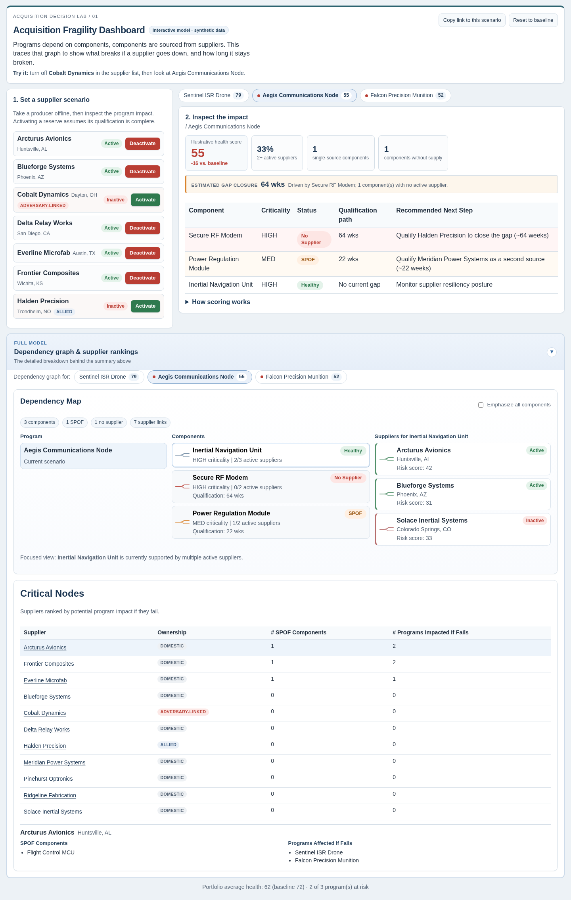

# Acquisition Fragility Dashboard

**[Live demo →](https://acquisition.mattvildibill.com)**

[Legacy GitHub Pages demo](https://mattvildibill.github.io/acquisition-fragility-dashboard/) remains supported.

A small tool for one question: **if a supplier goes down, which programs stop, and how long are they stopped for?**

Supplier risk usually lives in a spreadsheet — a list of vendors with a risk score next to each. That tells you a vendor looks shaky. It doesn't tell you that the shaky vendor is the only qualified source for a part that three programs depend on, or that the nearest alternate is 64 weeks of qualification away. This models the dependency graph so you can ask the second question.



## Try it

```bash
npm ci
npm run dev
```

The 30-second version, using the seeded demo data:

1. **Baseline.** Portfolio health sits at 72 and none of the three program tabs show a red at-risk dot.
2. **Deactivate Cobalt Dynamics** in the supplier list on the left — it's the sole source for the Secure RF Modem, and it's tagged adversary-linked.
3. Two tabs pick up a red dot: Aegis Communications Node 71 → 55, Falcon Precision Munition 65 → 52. The Secure RF Modem now has no active supplier at all.
4. **Click Aegis in the affected dependency path.** Compare baseline 71, disrupted 55, choice A 71 and choice B 84 in one ledger.
5. **Read the tradeoff.** A qualifies Halden to close the modem gap. B also qualifies Meridian for power-module redundancy. Both have a synthetic 64-week qualification envelope, but the modem remains single-sourced in both. Open calculation evidence for every qualification link.

## Case study: recovery without false precision

The centerpiece follows a lost producer through component dependencies into programs, then compares two explicit policies. **A closes current gaps; B also seeks redundancy for fragile components.** Neither is an optimizer or a recommendation to buy. Choices are read-only previews and preserve the current scenario and the existing score calculations.

Selection uses component ID order, then the shortest per-part reserve qualification with supplier-ID tie-breaking. Offline baseline producers are excluded. The existing model activates suppliers across every linked part, so the qualification envelope includes all those parts, even outside the selected program. All qualifications run in parallel with unlimited capacity. Scores show the state after that work completes, not a predicted state today. Unmet goals stay visible rather than receiving a fabricated recovery path.

The visual hierarchy puts affected paths and a shared baseline/current/choice ledger first. Detailed scores, rankings and assumptions remain inspectable. Reserve suppliers are distinguished from producers taken offline. No cost data, real dates, backend, exports or saved scenario library were introduced.

## What it models

Three entity types and two link tables, kept as an explicit graph rather than a flattened join:

```
Program  --requires-->  Component  --sourced from-->  Supplier
```

Each component gets a status from how many of its suppliers are currently producing:

| Active suppliers | Status | Meaning |
| --- | --- | --- |
| 2+ | Healthy | Has redundancy |
| 1 | SPOF | Delivering, but one failure from a gap |
| 0 | No supplier | Capability gap — the line stops |

**Qualification lead time** lives on the component–supplier link, not on the supplier. Qualification is per-part: the same vendor can be a drop-in for one board and an 18-month first-article effort for another. That's what makes a restore estimate possible.

**Ownership exposure** (domestic / allied / adversary-linked) is tracked but deliberately kept *out* of the health score. See below.

## The score

Each program starts at 100 and loses weighted penalties:

- SPOF component: `45 × criticality weight`
- No supplier: `90 × criticality weight`
- Criticality weights: LOW 1.0, MED 1.5, HIGH 2.0
- Total penalty is normalised by the program's total criticality weight, so a 4-component program and a 12-component program are comparable

Every number on screen traces back to a specific component and a specific supplier. There's no fitted model here, which is the point — in a review, "why did this drop 16 points" needs an answer you can say out loud.

### Two design calls worth explaining

**Restore time only counts components at zero active suppliers.** My first version included SPOFs, and the headline number never moved — almost everything is a SPOF at baseline, so the estimate was pinned to the worst qualification lead time in the dataset no matter what you did. A SPOF is fragile but still delivering. A gap is what stops a line.

**Ownership exposure is not in the score.** It's tempting to add a penalty and get one number. But second-sourcing fixes availability and does nothing about who owns the vendor — they're different problems with different remedies and different timelines. Rolling them together produces a score that goes down for two unrelated reasons and tells you nothing about which lever to pull. Adversary-linked sole sources get their own counter instead.

## What's wrong with it

Being specific, because most of this is load-bearing if anyone tried to use it:

- **The score floor is 10, not 0.** Penalties are normalised by total weight and the worst per-component penalty is 90, so a program with every component stranded scores 10. There's a test pinning this. A real version should rescale.
- **The constants are invented.** 45, 90, and the 1.0/1.5/2.0 weights are my judgement, not calibration. They produce sensible orderings on this dataset; I have no evidence they're right in general. The 2× weight on blast radius in the critical-node ranking is the same story.
- **Supplier state is binary.** Real disruption is partial and time-phased — reduced capacity, allocation, a six-month lead time stretch. On/off is a coarse approximation, and it means the tool can't represent the most common real case.
- **No sub-tier visibility.** Every real single point of failure I've read about lives two or three tiers down, at a foundry or a specialty alloy mill that no prime has on a diagram. This models tier one only, which is the easy part.
- **Restore assumes gaps close in parallel** and that qualification is the only constraint. No engineering capacity, no tooling, no funding line.
- **Ownership exposure is an enum someone typed into a JSON file.** The real version of that field is an entity-resolution problem over corporate hierarchies, and it's harder than everything else here combined.
- **Scenarios aren't persisted server-side.** There's a "copy link to this scenario" button that encodes supplier state into the URL, which works for sharing one link but breaks if the dataset changes underneath it, and there's no way to name or list past scenarios. Incomplete or malformed snapshots are rejected with a visible baseline fallback. The July layout simplification deliberately removed local save/load lists to keep the failure-to-impact interaction central.
- **"No alternate on file" is real code with no reachable case in this dataset.** Every component now has at least one supplier sitting on the shelf, so deactivating everything you can — I checked, all six active suppliers at once — still resolves to a number everywhere. The path is exercised by a hand-built fixture in `scoring.test.ts`, not by anything you can click into here. A dataset with a genuinely sole-sourced, no-alternate part would need to reintroduce that gap on purpose.

## If it had real data

The model is the easy half. What would make it useful is the ingest: contract and obligation history to find who actually delivers a part, corporate hierarchy resolution for the ownership question, and sub-tier discovery to get past tier one. Qualification lead times would come from program offices rather than from me making them up.

Activating a reserve supplier is a what-if assumption that qualification has already finished; the app does not simulate time passing. A program with any gap that has no alternate has no complete recovery estimate, even if its other gaps have estimates.

The scoring engine is deliberately isolated in `src/lib/scoring.ts` with the dataset behind a single import, so swapping the static JSON for an API is a small change. That was the one piece of architecture I bothered with.

## Tests

```bash
npm test
```

46 tests over the scoring engine, recovery comparison and share-link encoding. A few run against the demo dataset specifically to keep the walkthrough above honest — if I change a supplier and the numbers in this README go stale, those fail.

Writing them turned up two real bugs: a supplier knocked offline by a scenario was being recommended as its own replacement, and the "top critical supplier" callout could name a different vendor than the top row of the table right below it. Both are fixed; both have tests.

To repeat the browser smoke check, run `npx playwright install chromium`, start `npm run preview -- --port 4180` after building, then run `npm run test:browser` in another terminal. Set `BASE_URL` to check another served build, or `BROWSER_EXECUTABLE_PATH` to use an existing Chromium installation. The smoke check includes axe WCAG A/AA rules; it does not deploy anything.

The unit suite covers the model and share-link parser. The UI is checked separately in Chromium: failure and mitigation scenarios, reset, shared links, clipboard-denied fallback, keyboard controls and narrow layouts. It does not claim cross-browser or screen-reader certification.

## Stack

React, TypeScript, Vite. No component library, no state management library, no backend — the whole thing is a static build.

```
src/lib/scoring.ts     scoring engine, no React imports
src/data/              types and the seeded dataset
src/components/        everything else — panels, tabs, the dependency graph
```

## Data

Everything in `src/data/dataset.json` is synthetic. Program names, suppliers, and lead times are invented to exercise the model — three programs, six components, eleven suppliers, with a couple of scenarios worth clicking through. Nothing here is derived from real programs or real vendors.

## Hosting and scope

Use Node 22.12+ (Node 22 LTS is used by CI). `npm run build` produces a static `dist/` directory. Relative asset paths support both a root subdomain on Vercel and the existing GitHub Pages project path. There are no environment secrets, API calls, accounts or backend to provision.

For a Vercel project, use the Vite preset, build command `npm run build`, and output directory `dist`. Deployment and domain assignment are separate from this code change. The intended showcase is public but unlinked from the main portfolio. `noindex, nofollow` metadata and Vercel response headers discourage indexing; they are not access control.

The review keeps the existing illustrative score constants and synthetic dataset. It adds no claims about real procurement programs, customers or operational outcomes. No export workflow is included.
